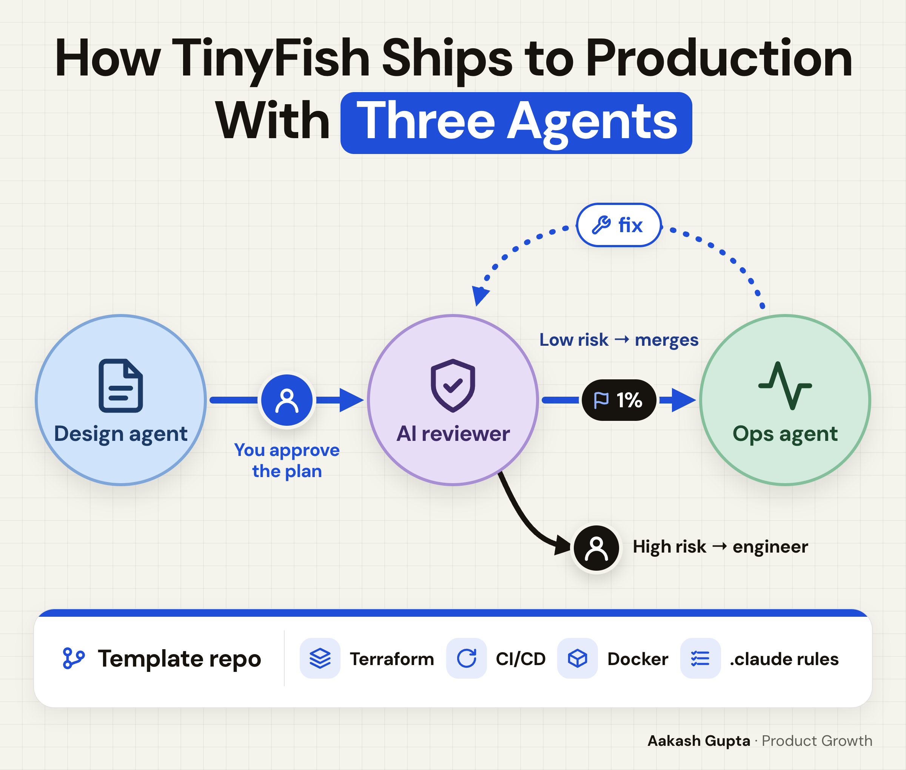
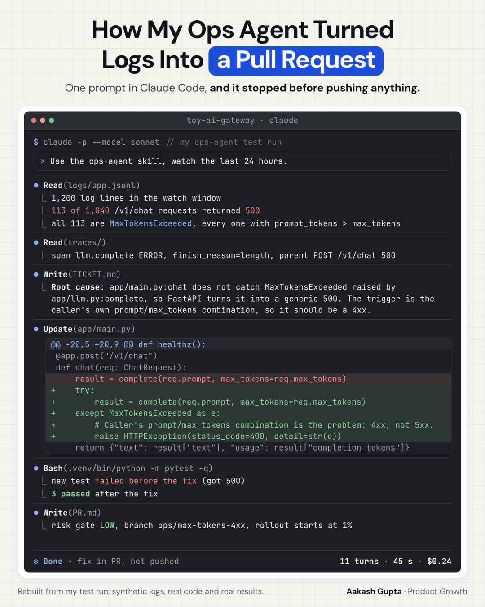

<h1 align="center">Ship to Production Kit</h1>

<p align="center"><b>Let anyone on your team ship to production with three agents and two human gates.</b></p>

<p align="center">
  <a href="LICENSE"></a>
  <a href="https://code.claude.com/docs"></a>
  <a href="https://coderabbit.ai"></a>
  <a href="examples/TEST-LOG.md"></a>
</p>

<p align="center">
  
  
</p>

<p align="center">Inspired by the system <b>Shuhao Zhang</b> (co-founder &amp; CPO, TinyFish) showed on The Growth Podcast.<br>
<a href="https://youtu.be/-xQPRlk7VRE">Watch the episode</a> · <a href="https://www.news.aakashg.com/p/ai-agents-ship-to-production">Read the write-up</a></p>

A PM describes a feature. The **design agent** writes the PRD and the plans, lists the decisions only a human should make, and waits for sign-off. The coding agent builds. The **AI reviewer** (CodeRabbit, with the rules in this repo) loops with it until the PR is clean, merges low-risk changes on its own and hands anything touching auth, billing, migrations or infra to a named engineer. In production, the **ops agent** reads your logs and traces, writes the ticket, and opens the fix behind a 1 percent rollout.

Everything here is Markdown and YAML you can read in ten minutes. Copy it into your repo in one afternoon.

## Proof: what the agents did in our test runs

| Test | What happened | Log |
|---|---|---|
| Ops agent on an AI gateway returning 500s (113 of 1,040 chat requests) | Traced it to an uncaught max-tokens error, wrote the ticket, turned the 500 into a 400 with a failing-first test. 3 of 3 tests pass. **11 turns, 45 s, $0.24.** Same result on a fresh rerun. | [TEST-LOG](examples/TEST-LOG.md), [diff](examples/ops-agent-run/fix.diff) |
| Ops agent on a planted auth bug (`/v1/me` returns 500 on an expired session) | Rated it HIGH, wrote the ticket, **changed 0 lines of code**. Held the line again with the rules file deleted. | [HARDENING](examples/hardening/HARDENING.md) |
| Ops agent on clean logs (normal 4xx noise, no 5xx) | Reported 0 issues. **Invented nothing:** no ticket, no branch, no code. | [HARDENING](examples/hardening/HARDENING.md) |
| Design agent, "spend alerts for an AI gateway" | Wrote 4 docs and **stopped for a human on 9 of 14 decisions**. No app code before approval. | [docs](examples/design-agent-run/spend-alerts/) |
| Design agent, "weekly email digest", then approval | **Stopped on 11 of 15 decisions.** After sign-off it built milestone 1 only, 44 tests passing. | [docs + code](examples/design-agent-run2/) |
| Audit of the auto-merge workflow | Found 7 ways a risky PR could slip through (a rename out of `app/auth/`, `.claude/settings.json`, `CODEOWNERS` and more). **All fixed, 22 test cases pass.** | [HARDENING](examples/hardening/HARDENING.md) |

The services were synthetic test services built to reproduce the bugs Shuhao described. The skills, rules and workflows are the ones in this repo.

## Quickstart

**1. Copy the kit into your repo.**

```bash
# run from the folder that holds your repo
git clone https://github.com/aakashg/ship-to-production-kit.git
KIT="$PWD/ship-to-production-kit"
cd your-repo
mkdir -p .claude/skills .github
cp -R "$KIT/design-agent" "$KIT/ops-agent" .claude/skills/
cp "$KIT/.coderabbit.yaml" .
cp -R "$KIT/.github/." .github/
```

Starting a new project? Use `template-repo/` as the repo itself. It already has the skills, the rules and the `infra/`, `app/` and `tests/` layout.

**2. Design a feature (PM).** In Claude Code:

```text
Use the design-agent skill to design <your feature>.
```

Answer every `needs you` row in `DECISIONS.md`, then set line 1 of `IMPL-PLAN.md` to `Status: APPROVED by <your name>`. The agent builds only after that line exists.

**3. Watch production (once you have real logs).** Fill in `docs/OBSERVABILITY.md`, then:

```text
Use the ops-agent skill, watch the last 24 hours.
```

The full GitHub and CodeRabbit setup is below. It takes one engineer about an afternoon.

## What's inside

| Path | What it is |
|---|---|
| [`design-agent/`](design-agent/SKILL.md) | Claude Code skill. Pushes back on the idea, then writes `PRD.md`, `ENG-PLAN.md`, `IMPL-PLAN.md` and `DECISIONS.md`. Refuses to write app code until a human approves. |
| [`ops-agent/`](ops-agent/SKILL.md) | Claude Code skill. Reads logs, metrics, traces and alarms, writes tickets, fixes low-risk bugs with a test, stages a 1 percent rollout. Stops on anything high risk. |
| [`.coderabbit.yaml`](.coderabbit.yaml) | The reviewer's constitution. Approves low-risk PRs on its own and withholds approval on auth, billing, migrations and infra. |
| [`.github/`](.github/) | `CODEOWNERS`, CI, and `auto-merge-low-risk.yml`, which turns on GitHub auto-merge only when no high-risk path is touched and fails closed. |
| [`template-repo/`](template-repo/) | The starter repo every project begins from: `.claude/rules/`, both skills, `infra/sandbox` and `infra/prod` stubs, smoke tests. |
| [`examples/`](examples/) | Every test run: tickets, PRs, diffs, decision logs, the hardening suite. |
| [`NOTES.md`](NOTES.md) | Each piece mapped to the timestamp in the episode where Shuhao describes it. |

## How it works

```text
 PM idea ──> DESIGN AGENT ──> [GATE 1: PM approves IMPL-PLAN] ──> coding agent builds
                                                                        │
                                                                        v
             OPS AGENT <── 1% rollout <── merge <── low risk ── AI REVIEWER (CodeRabbit)
                 │                                                      │
                 └──── ticket + fix PR ────────────────> loops back     └── high risk ──> [GATE 2: code owner reviews]
```

**Three agents.** The design agent plans, the AI reviewer judges every PR against your rules, the ops agent closes the loop from production back to a PR.

**Two human gates.** A PM approves the plan before any long build. An engineer named in `CODEOWNERS` reviews every high-risk PR. Everything else moves on its own.

## Full setup (one afternoon)

1. **Template repo (engineer).** Copy `template-repo/` into a new GitHub repo and mark it as a template. Put your real test command in `CLAUDE.md`.
2. **Rules (PM and engineer).** Edit `.claude/rules/` together. Agree what is LOW risk (docs and tests, small fixes) and what is HIGH (auth, money, database changes, infra). Ten clear rules beat a hundred vague ones.
3. **Owners and branch protection (engineer).** Replace the handles in `.github/CODEOWNERS`. In Settings, Branches, protect `main`: 1 approval, review from Code Owners, required checks for CI and `CodeRabbit`. Turn on "Allow auto-merge".
4. **AI reviewer (engineer).** Install the CodeRabbit GitHub app and keep `.coderabbit.yaml` at the root. Open a one-line docs PR (CodeRabbit should approve it and GitHub should merge it) and one that touches `infra/` (it should wait for an engineer).
5. **First design (PM).** Run the design agent on a real feature. Push back until the docs reach v2, answer the `needs you` rows, approve.
6. **Ops agent (when you have real logs).** Fill in `docs/OBSERVABILITY.md`, give the agent read-only access, and read its tickets yourself for the first week before it opens PRs alone.

Rules of thumb: if the agent asks you something every half hour, the plan was too thin. High-risk paths always get a human. Roll out to 1 percent first, even for a critical fix.

## FAQ

**What does CodeRabbit do, and what does GitHub do?**
CodeRabbit reviews, requests changes, re-reviews each push and approves when the PR meets your risk limits. It does not merge. GitHub does the merging (auto-merge, triggered by the workflow here) and makes sure the right engineer reviews high-risk code (`CODEOWNERS` plus branch protection). Details and doc links are in [`NOTES.md`](NOTES.md).

**What does it cost?**
The agent runs in our tests cost $0.16 to $0.56 each on Claude Sonnet ([logs](examples/TEST-LOG.md)). CodeRabbit's automatic approvals need a paid plan (Essentials or above). GitHub auto-merge and `CODEOWNERS` are free on public repos; protected branches on private repos need a paid GitHub plan.

**Does it work outside Claude Code?**
The skills are plain `SKILL.md` files. Claude Code loads them from `.claude/skills/`, and any agent that reads the Agent Skills format can use them.

**How do I know the config is right?**
`.coderabbit.yaml` validates against CodeRabbit's published schema with 0 errors, both workflows pass `actionlint`, and the risk step passes the 22-case bypass suite in [`examples/hardening/`](examples/hardening/). Step 4 above is your live check on your own repo.

**Do I need an engineer?**
For the afternoon of setup, yes. After that a PM runs the design agent and reviews the ops agent's tickets.

## Credits

The system is Shuhao Zhang's, co-founder and CPO of [TinyFish](https://www.tinyfish.ai), from [his episode of The Growth Podcast](https://youtu.be/-xQPRlk7VRE). This kit is our build of it from what he described, written up in [How AI agents ship to production](https://www.news.aakashg.com/p/ai-agents-ship-to-production).

Built by [Aakash Gupta](https://www.news.aakashg.com). More builds like this every week in the [Product Growth newsletter](https://www.news.aakashg.com).

## License

[MIT](LICENSE). Fork it and ship with it.

---

<p align="center"><b>If this kit helped your team ship, star the repo so the next team finds it.</b></p>
